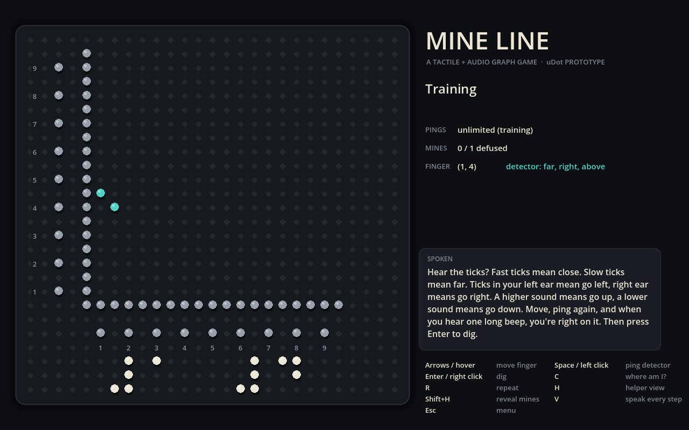

# Mine Line

**A tactile + audio graph game for blind and visually impaired kids**, prototyped for the [uDot](https://udot.tech) refreshable tactile display.

**Play it:** _itch.io link coming soon_ · **Design doc:** [docs/design-doc.pdf](docs/design-doc.pdf) ([markdown](docs/design-doc.md))


A saboteur has buried mines across a field, **always in a pattern**: a flat row, a staircase, a downhill line, steep stairs. You find them with a sonar detector before the fuse burns down. Find three, and the rest of the line **chain-defuses** in a run of rising chimes. Spotting the pattern is how you win, and that is the lesson: coordinates, "two points make a line", and slope as "up 2 for every 1 across", learned without anyone saying the word *graph*.

Built for a 10-year-old who can't see the screen. Everything is playable with **touch and sound alone**. The screen just simulates the pin display, plus an optional helper view for sighted adults.

## How to play

Turn the sound on. Headphones are best, because direction is in stereo. Then close your eyes.

1. **Move your finger** across the field. Each step clicks, and **higher rows sound higher**.
2. **Ping** the detector. Fast ticks mean close and slow ticks mean far. Left ear means the mine is to the left. A higher pitch means the mine is above you. One long steady tone means it's right under your finger.
3. **Dig** to defuse. Dig an empty spot and the fuse jumps ahead 5 seconds.
4. After two mines, think: *how far across, how far up?* **Guess the third without pinging.** That saves pings, and pings left mean stars.
5. Find three and the rest chain-defuse. If the fuse runs out, **BOOM**, and every hidden mine rises so you can feel the pattern you missed.

Start with **Training**. It teaches itself in about a minute, one action at a time.

## Controls

| Action | Keyboard | Mouse (simulates a finger) |
|---|---|---|
| Move | Arrow keys | Hover |
| Ping detector | Space | Left click |
| Dig / defuse | Enter | Right click |
| Where am I? (coordinates, pings, fuse) | C | |
| Repeat last spoken line | R | |
| Speak position on every step | V | |
| Helper view on/off (sighted adults) | H | |
| Teacher: reveal hidden mines | Shift+H | |
| Menu | Esc | |
| Unlock all missions (for reviewers) | Shift+U on the menu | |

## What's on the pins

The display is a 27×26 pin grid. The playfield is 9×9 cells of 2×2 pins.

- **Axes:** a raised x-axis and y-axis, with a tick mark per cell so you can count your position.
- **Your finger:** a diagonal pair of pins. On the real device your finger *is* the cursor.
- **A defused mine:** a full 2×2 block. **An empty dig:** a single pin, so you can feel where you've already dug.
- **Status line:** real 6-dot braille along the bottom, with the number sign, showing `x y pings`.
- **Slow refresh:** the frame only updates every 0.2 s, like a physical pin display. The chain defuse uses this deliberately, so the pins rise one after another like dominoes.

| Helper view | What the child "sees" (helper view off) |
|---|---|
|  |  |

## Sound design

All sound is **synthesised in code** at startup (`scripts/sfx.gd`), so there are no audio files. The design uses one rule throughout: **left/right is stereo pan, up/down is pitch**.

- Footsteps are pitched on a pentatonic scale by row, so moving up plays a rising scale.
- Detector ticks: tick rate gives distance, pan gives left/right, pitch gives above/below.
- The chain defuse and the "mission complete" replay play **the line as a melody**: a staircase sounds like a rising scale and a downhill line like a falling one. This is how scientists turn data into sound for blind researchers.
- The fuse is a fizzing hiss with a tick that speeds up at 20, 10 and 5 seconds. BOOM is filtered noise plus a falling sub-bass.
- Speech uses the platform text-to-speech (Web Speech API in browsers) and prefers an Indian-English voice. Every line is mirrored to captions.

## Project layout

```
scripts/config.gd           grid size, pins per cell, refresh rate, rules, level data: one place to retarget hardware
scripts/braille.gd          6-dot braille letters, number sign, digits
scripts/tactile_display.gd  pin buffer with throttled refresh and pin-rise animation
scripts/sfx.gd              procedural sound synthesis + stereo panning
scripts/speech.gd           text-to-speech wrapper, captions, repeat
scripts/game.gd             game states, tutorial, detector, digging, chain, fuse, scoring, save
tests/smoke_test.gd         headless play-through (24 checks)
docs/                       design doc (md + pdf), screenshots, demo video script, itch upload guide
```

## Run / build

- **Engine:** Godot 4.6 (GL Compatibility renderer).
- **Run:** open the folder in Godot and press F5.
- **Tests:** `godot --headless --path . -s tests/smoke_test.gd`
- **Web build:** `godot --headless --path . --export-release "Web" build/web/index.html`. This is a single-threaded export, so it needs no special server headers and runs on itch.io as-is.

## Porting to uDot hardware

The display is a plain pin buffer (`set_pin(x, y, on)`) committed on a refresh tick. A port swaps the renderer for uDot's pin driver and wires touch and buttons to the existing move / ping / dig actions. All hardware-shaped numbers are in `scripts/config.gd`.

---

Made by Nishaad Gangal for the uDot Braille Tech Game Design Intern challenge.
