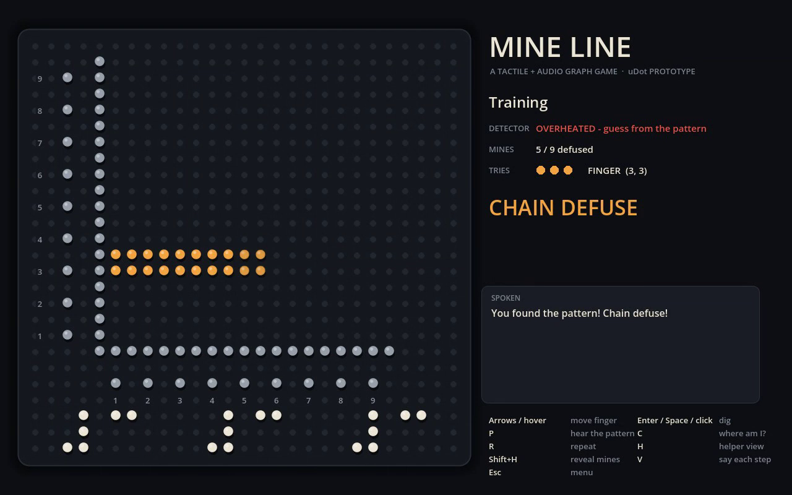
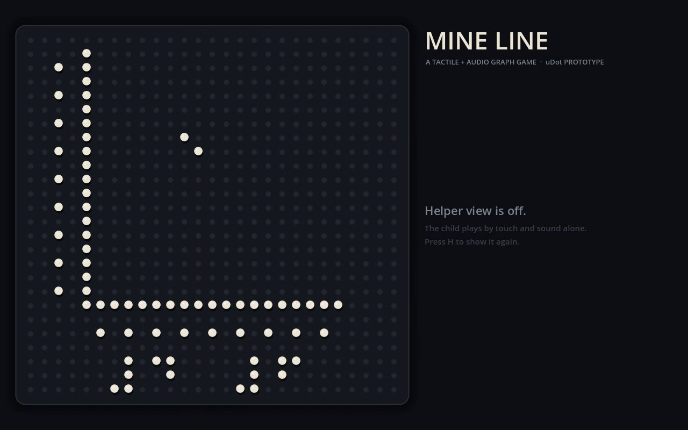
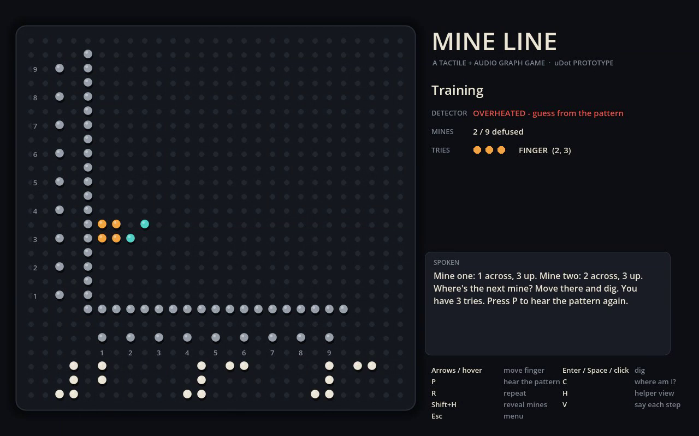

# Mine Line

**A tactile + audio graph game for blind and visually impaired kids**, prototyped for the [uDot](https://udot.tech) refreshable tactile display.

**Play it:** _itch.io link coming soon_ · **Design doc:** [docs/design-doc.pdf](docs/design-doc.pdf) ([markdown](docs/design-doc.md))



A saboteur has buried mines **along a line**, so every column hides exactly one. Find two with your detector, which ticks faster the closer you get, like hot-and-cold. Then the detector overheats, and you have to **guess the next mine from the pattern**. Guess right and the whole line **chain-defuses** in a run of chimes. Miss three times and it's **BOOM**, and the line rises so you can feel it. Predicting the next point from two points is the lesson: coordinates and slope ("1 across, 2 up"), learned without anyone saying the word *graph*.

Built for a 10-year-old who can't see the screen. Everything is playable with **touch and sound alone**. The screen just simulates the pin display, plus an optional helper view for sighted adults.

## How to play

Turn the sound on and close your eyes. Headphones help.

**Search (hot and cold)**
1. **Left/right picks a column.** Every column has one mine.
2. **Up/down slides along it.** The detector is always on: slow ticks mean far, **faster ticks mean closer**, and a **steady beep** means you're right on top of it.
3. **Dig** (Enter) on the steady beep. Dig an empty spot and the fuse jumps ahead 5 seconds.
4. Find a second mine the same way, in another column.

**Predict (the maths)**
5. The detector **overheats**. The robot tells you where your two mines are and plays them as notes (higher note = higher up).
6. Work out the pattern. For example, mines at 5 across, 5 up and 6 across, 6 up means the next is at 7 across, 7 up. Move there and dig. You get **3 tries**, and a wrong guess tells you "higher" or "lower".
7. Right: **chain defuse**, the whole line goes off, and stars equal the tries you had left. Out of tries: **BOOM**.

Start with **Training**. It teaches itself in about a minute, one action at a time.

## Controls

| Action | Keyboard | Mouse (simulates a finger) |
|---|---|---|
| Move | Arrow keys | Hover |
| Dig / defuse | Enter or Space | Click |
| Hear the pattern (found mines as notes) | P | |
| Where am I? (position, your mines, tries, fuse) | C | |
| Repeat last spoken line | R | |
| Speak position on every step | V | |
| Helper view on/off (sighted adults) | H | |
| Teacher: reveal hidden mines | Shift+H | |
| Menu | Esc | |
| Unlock all missions (for reviewers) | Shift+U on the menu | |

## What's on the pins

The display is a 27×26 pin grid. The playfield is 9×9 cells of 2×2 pins.

- **Axes:** a raised x-axis and y-axis, with a tick mark per cell so you can count your position.
- **Your finger:** a diagonal pair of pins. On the real device your finger *is* the cursor.
- **A defused mine:** a full 2×2 block. **An empty dig or wrong guess:** a single pin, so you can feel where you've already tried.
- **Status line:** real 6-dot braille along the bottom, with the number sign, showing `x y` (and tries left once you're predicting).
- **Slow refresh:** the frame only updates every 0.2 s, like a physical pin display. The chain defuse uses this deliberately, so the pins rise one after another like dominoes.

| Searching (helper view) | What the child gets (helper view off) |
|---|---|
|  |  |
| **Predicting** after the detector overheats | **BOOM**: the missed line rises to be felt |
|  |  |

## Sound design

All sound is **synthesised in code** at startup (`scripts/sfx.gd`), so there are no audio files. The rule is **one cue per meaning**:

- **Detector:** a Geiger click whose *speed* is the only signal: faster means closer. On the mine it becomes a steady tone. Nothing else to decode.
- **Pitch means height**, used only for the line itself. P replays your found mines as notes, and the chain defuse and win replay play **the whole line as a melody**: a staircase sounds like a rising scale, a downhill line like a falling one. This is how scientists turn data into sound for blind researchers.
- Overheat is a rising whine with steam, a wrong guess is a small pop, and BOOM is filtered noise plus a falling sub-bass. The fuse is a fizzing hiss with a tick that speeds up at 20, 10 and 5 seconds.
- Speech uses the platform text-to-speech (Web Speech API in browsers) and prefers an Indian-English voice. Every line is mirrored to captions.

## Project layout

```
scripts/config.gd           grid size, pins per cell, refresh rate, rules, level data: one place to retarget hardware
scripts/braille.gd          6-dot braille letters, number sign, digits
scripts/tactile_display.gd  pin buffer with throttled refresh and pin-rise animation
scripts/sfx.gd              procedural sound synthesis + stereo panning
scripts/speech.gd           text-to-speech wrapper, captions, repeat
scripts/game.gd             game states, tutorial, search/overheat/predict loop, chain, fuse, scoring, save
tests/smoke_test.gd         headless play-through (26 checks)
docs/                       design doc (md + pdf), screenshots, demo video script, itch upload guide
```

## Run / build

- **Engine:** Godot 4.6 (GL Compatibility renderer).
- **Run:** open the folder in Godot and press F5.
- **Tests:** `godot --headless --path . -s tests/smoke_test.gd`
- **Web build:** `godot --headless --path . --export-release "Web" build/web/index.html`. This is a single-threaded export, so it needs no special server headers and runs on itch.io as-is.

## Porting to uDot hardware

The display is a plain pin buffer (`set_pin(x, y, on)`) committed on a refresh tick. A port swaps the renderer for uDot's pin driver and wires touch and buttons to the existing move / dig / pattern actions. All hardware-shaped numbers are in `scripts/config.gd`.

---

Made by Nishaad Gangal for the uDot Braille Tech Game Design Intern challenge.
