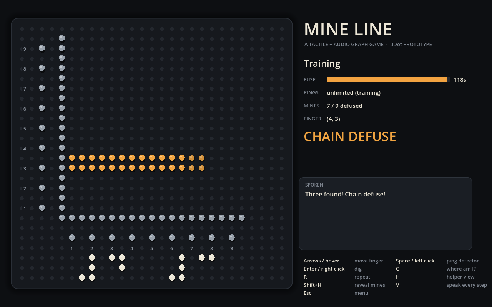
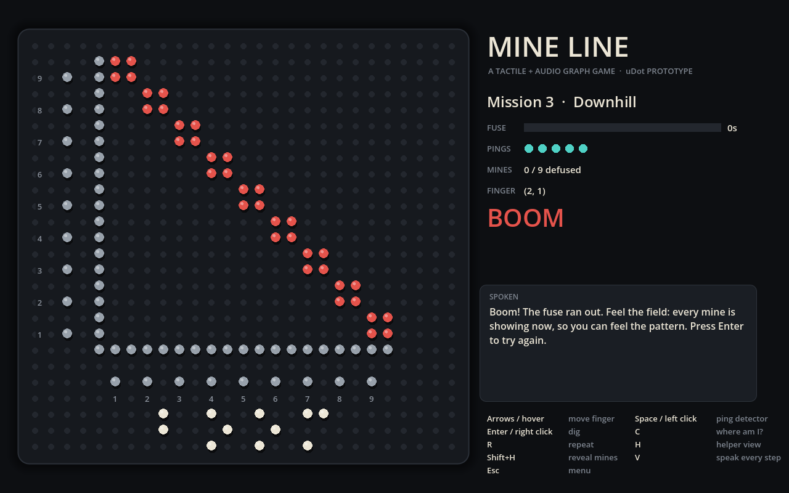

# Mine Line

**A tactile + audio graph game for the uDot display** · Nishaad Gangal · Game Design Intern challenge, uDot Braille Tech

> A saboteur has buried mines across a field, **always in a pattern**. Find them with a sonar detector before the fuse burns down. Find three and the rest of the line defuses in one chain. The child wins by spotting the line, which is the graph lesson.

**Player:** a blind or visually impaired 10-year-old. **Session:** 2–5 minutes, one mission per sitting. **Teaches:** coordinates, plotting points, "two points make a line", and slope as "up N for every 1 across". These are uDot's graph lessons, played as a bomb-squad game.

## 1. What does the player feel, hear and do, moment to moment?

The field is a 9×9 grid. Each cell is a 2×2 block of pins, framed by a raised **x-axis and y-axis with a tick mark every cell**, so the child can always count where they are.

| Do | Feel (pins) | Hear (stereo audio) |
|---|---|---|
| **Move** (finger / arrows) | Their finger, or a diagonal pin pair in the browser | A soft click whose **pitch rises with the row**, panned left to right by column. Moving up *sounds* like going up. |
| **Ping** the detector (limited charges) | — | Ticks: **rate = distance, pan = left/right, pitch = above/below**. One steady tone means "you're on it". |
| **Dig** (defuse) | A found mine becomes a full 2×2 block. An empty dig leaves a single pin, a memory of where they've been. | Two tense beeps and a chime pitched to the mine's height. An empty dig gives a dirt thud and *"the fuse jumps ahead"* (5 s penalty). |
| **Chain defuse** (3rd mine) | Every remaining mine rises **one after another along the line** | A run of chimes climbing or falling with the line: **the line played as a melody**. |
| **Fuse** | — | A fizzing hiss and a tick that speeds up. At 0: **BOOM**, the pins flash, then every hidden mine rises so the child can *feel the pattern they missed*. |

The display's slow refresh is part of the design rather than a problem. The grid holds slow, stable truth (the axes, found mines, dug holes) that a child reads at their own pace. Sound carries everything that happens in time: direction, urgency, reward. The chain defuse uses the slow refresh on purpose, so the pins rise like dominoes falling.

## 2. How does the game teach itself, with no adult?

Training has a gate at each step. Nothing moves on until the child has *done* the thing being taught, and every instruction is one action long:

1. *"Go all the way left until you hear a bump."* The bump teaches edges and the axis.
2. *"Press C to hear where you are."* This teaches coordinates as "3 across, 4 up".
3. *"Press Space to ping, then listen."* The child feels and hears the detector before it's explained.
4. *"Fast ticks mean close… a higher sound means go up."* With unlimited pings and no fuse, they find their first mine.
5. Then a row lesson with the fuse lit: find 3 and the rest chain. A robot sidekick (a higher voice and a chirp) says *"they make a pattern… guess the next one"*.

**R** repeats the last line at any time. Speech is short and interruptible, never a menu read aloud. Sound itself teaches: the same pitch-means-height rule runs through moving, pinging and the chain melody, so the child learns one rule once.

## 3. What makes the child want to play again tomorrow?

- **Booms.** Losing is loud and funny, never shaming, and it ends by showing the answer to feel. *"Let me try again"* is the core loop.
- **Mastery you can hear.** Stars come from **pings left, no wasted digs and time left**, so a child who *predicts* the line instead of searching beats one who brute-forces. The way to improve is to understand the graph.
- **Collecting lines.** Each mission is a new saboteur pattern (flat, staircase, downhill, steep) with its own melody. A rank goes Recruit, then Mine Sweeper, Expert Defuser and Bomb Squad Captain. Stars persist between sessions.
- **Next (designed, not built):** a daily saboteur with the same pattern for the whole class (a classroom leaderboard), curve levels (hills), and Minesweeper-style counts on safe digs for older players.

## 4. The first thing I'd test with real kids, and how

**Question:** *Can a child find a mine from the detector sound alone, without help, in under a minute?* If they can't, nothing else in the game matters.

**How:** five or six kids, one at a time, Training step 3 only, on the device (or the browser build with headphones). No coaching. I'd record time to first mine, number of pings, which ear or which pitch confused them, and where they hesitate or ask an adult. Then I'd swap one mapping at a time, for example pitch for up/down versus a "warmer/colder" voice, and re-run with the next child. Teachers watch, and I write down what makes kids lean in (I expect it to be the boom). Success: 4 of 6 find the mine unaided, and at least one asks to play again.

## Controls → uDot hardware

| Action | Browser prototype | uDot device (proposed) |
|---|---|---|
| Move | Arrow keys / mouse hover | Finger position on the pins (touch) |
| Ping | Space / left click | Single tap |
| Dig | Enter / right click | Press-and-hold or a select button |
| Repeat / where am I | R / C | Two hardware buttons |
| Sighted helper view | H (Shift+H reveals mines for teachers) | Teacher screen |

## Accessibility decisions

- **Everything works by sound and touch alone.** Helper view (H) only adds captions and colour for sighted adults. With it off, the screen shows only the pins.
- **One rule, everywhere:** left/right is stereo pan, up/down is pitch.
- **No reading required to play.** Braille is a bonus (a status line showing x, y and pings in real 6-dot braille with the number sign), so it builds literacy without blocking play.
- **No time pressure until the child has learned the controls.** The fuse lights on the first move, never during an instruction. Inputs lock for 1.5 s after a boom or win, so mashing keys can't skip the payoff.
- **Indian-English voice preferred** when the system has one. Every spoken line also goes to captions.

## Porting to the uDot hardware

The prototype is Godot 4 (GDScript) and runs in any browser. All hardware-shaped values live in one file (`config.gd`): grid size, pins per cell, refresh rate, level data. The display is a plain pin buffer (`set_pin(x, y, on)`) committed on a refresh tick, so the port means **swapping the renderer for uDot's pin driver and wiring touch and buttons to the existing move/ping/dig actions**. At about 4,000 pins, uDot could run bigger fields (3×3-pin cells) or two fields side by side for head-to-head play. Sounds are synthesised in code, so there are no audio assets to license or ship.

| Chain defuse (helper view) | After a BOOM: the missed line rises to be felt |
|---|---|
|  |  |
