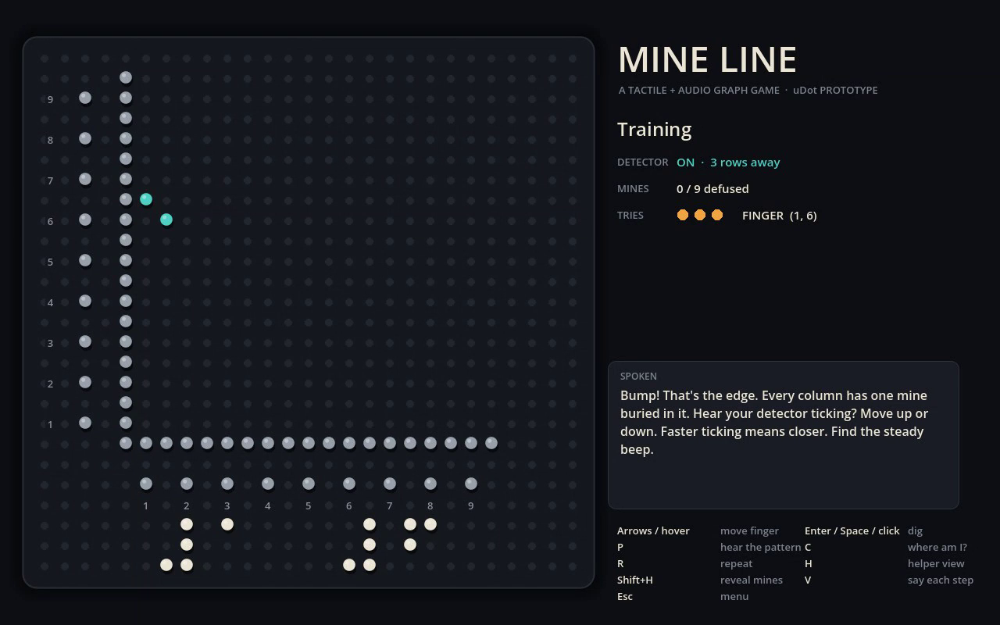

# Mine Line

**A tactile + audio graph game for the uDot display** · Nishaad Gangal · Game Design Intern challenge, uDot Braille Tech

> A saboteur has buried mines **along a line**, so every column hides exactly one. Find two with your detector by playing hot-and-cold. Then the detector overheats, and you have to **guess the next mine from the pattern**. Guess right and the whole line goes off safely in one chain. Guess wrong three times: **BOOM**.

**Player:** a blind or visually impaired 10-year-old. **Session:** 2–5 minutes, one mission per sitting. **Teaches:** coordinates, and predicting the next point of a line from two points ("1 across, 2 up"), which is slope without the word. These are uDot's graph lessons, played as a bomb-squad game.

## 1. What does the player feel, hear and do, moment to moment?

The field is a 9×9 grid of 2×2-pin cells, framed by raised **x- and y-axes with a tick mark every cell**. Each mission has two halves.

| Phase | Do | Feel (pins) | Hear |
|---|---|---|---|
| **Search** | Move the finger (or arrows). Left/right picks a column, up/down slides along it. | Finger position. Defused mines are full 2×2 blocks. | The detector is **always on** and Geiger-ticks **faster as you get closer** to the mine in your column. On it: a **steady beep**, so dig. One sound, one meaning. |
| **Overheat** | Listen. | The two found mines. | A rising whine. The robot reads back the two mines and plays them as notes (higher = higher up). |
| **Predict** | Move to where the next mine *should* be and dig. 3 tries. | Wrong guesses leave a single pin. | A wrong guess gives a small pop and *"lower"* or *"higher"*. Right gives a **chain defuse**: every mine rises in turn, chiming up or down the line, so you **hear the line as a melody**. |
| **BOOM** (out of tries, or the fuse) | — | Pins flash, then **every mine rises** so the child feels the line they missed. | The explosion, then the rule spoken: *"1 across, 1 up, every time."* |

The display's slow refresh is part of the design. The grid holds stable facts (axes, found mines, wrong guesses) that a child reads at their own pace. Sound carries everything that happens in time. The chain defuse uses the slow refresh on purpose, so the pins rise like dominoes falling.

## 2. How does the game teach itself, with no adult?

Training has a gate at each step. Every instruction is one action long, and the game only moves on when the child has *done* it:

1. *"Go left until you hear a bump."* This teaches the edge and the axis, then switches the detector on.
2. *"Move up or down. Faster ticking means closer. Find the steady beep."* The child learns hot/cold with one sound.
3. *"That steady beep means you're on top of it. Press Enter to dig!"*
4. *"Go right one column and find the next one."* The second mine is found the same way.
5. The detector overheats: *"Mine one: 1 across, 3 up. Mine two: 2 across, 3 up. Where's the next mine?"* The child predicts a flat line, and it chain-defuses.

**R** repeats the last line, **C** says where you are and which mines you've found, and **P** replays the found mines as notes. A wrong guess says "higher" or "lower", so a miss still teaches something.

## 3. What makes the child want to play again tomorrow?

- **Booms.** Losing is loud and funny, never shaming, and it ends by letting the child feel the answer.
- **Stars mean understanding.** 3 stars for a first-guess prediction, 2 for the second, 1 for the third, so the only way to improve is to read the line better. A rank goes Recruit, then Mine Sweeper, Expert Defuser and Bomb Squad Captain. Stars persist between sessions.
- **New lines to crack:** flat, staircase, downhill, steep stairs, each with its own melody.
- **Next (designed, not built):** a class-wide daily line (a leaderboard), curves, two-player "hide the line" where one child sets the pattern and the other cracks it.

## 4. The first thing I'd test with real kids, and how

**Question 1:** *Can a child find a mine with the hot/cold detector alone, without help, in under 30 seconds?* **Question 2:** *After two mines, do they predict the third, or guess randomly?*

**How:** five or six kids, one at a time, Training only, with headphones. No coaching. I'd log time to each mine, wrong digs, and where they pause or ask an adult, and play back each child's attempt to the teacher afterwards. If the search is slow, I'd tune the tick-rate curve. If the predictions are random, I'd try saying the step out loud ("from mine one to mine two: 1 across, 0 up"). Success: 4 of 6 find both mines unaided and predict the third within 2 tries.

## Controls → uDot hardware

| Action | Browser prototype | uDot device (proposed) |
|---|---|---|
| Move | Arrow keys / mouse hover | Finger position on the pins (touch) |
| Dig | Enter / Space / click | Press, or a select button |
| Hear the pattern / where am I / repeat | P / C / R | Three hardware buttons |
| Sighted helper view | H (Shift+H reveals mines for teachers) | Teacher screen |

## Accessibility decisions

- **Everything works by sound and touch alone.** Helper view (H) only adds captions and colour for sighted adults.
- **One cue per meaning.** Tick speed means distance, pitch means height (used only for the pattern), and stereo gives a light sense of place.
- **No reading required to play.** A braille status line (x, y, tries left, in real 6-dot braille) builds literacy without blocking play.
- **No pressure while learning.** Training has no fuse, and the fuse only lights on the first move. Inputs lock for 1.5 s after a boom or win, so mashing keys can't skip the payoff.

## Porting to the uDot hardware

The prototype is Godot 4 (GDScript) and runs in any browser. All hardware-shaped values live in `config.gd`: grid size, pins per cell, refresh rate, level data. The display is a plain pin buffer (`set_pin(x, y, on)`) committed on a refresh tick, so the port means **swapping the renderer for uDot's pin driver and wiring touch and buttons to move, dig and the three helper keys**. With about 4,000 pins, uDot could run bigger fields or two side by side. Sounds are synthesised in code, so there are no audio assets to license.

| Search: the detector speeds up as you near the mine | After BOOM: the missed line rises to be felt |
|---|---|
|  |  |
